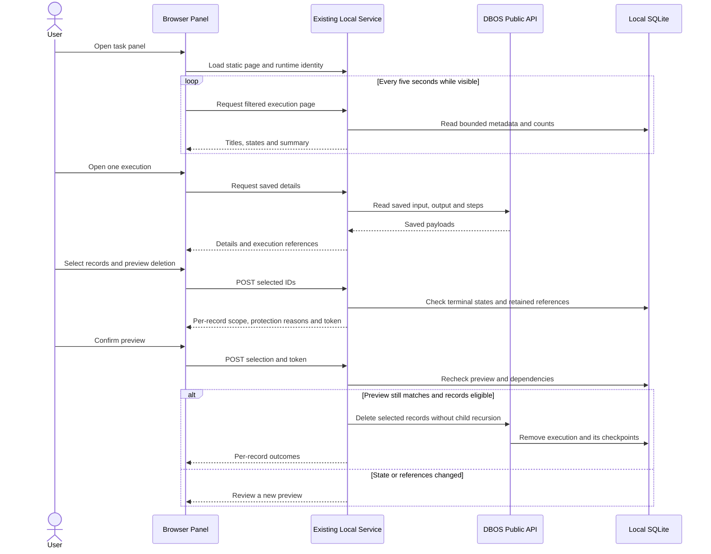

# Local service sequence diagrams

These diagrams describe process interactions. Business source/component/output
relationships remain in the root information-flow.drawio.

## Submit, execute and inspect

```mermaid
sequenceDiagram
    autonumber
    actor User
    participant CLI as CLI Client
    participant API as Local Service API
    participant Scheduler as DBOS Scheduler
    participant Triggers as Trigger Queue
    participant Jobs as Business Job Queue
    participant Worker as DBOS Executor
    participant State as Local SQLite
    participant Outputs as Notion and Reports

    Note over API,Outputs: One serve process owns DBOS and the runtime lock
    User->>Worker: Start serve in terminal A
    Worker->>State: Open runtime and recover compatible unfinished work
    Worker->>Scheduler: Apply configured schedules
    Worker->>API: Start loopback request listener

    par Manual submission
        User->>CLI: run JOB
        CLI->>API: POST /jobs with request ID
        API->>Jobs: Enqueue dispatch
        Jobs->>State: Persist request and input
        State-->>API: Durable submission confirmed
        API-->>CLI: Accepted with workflow ID
    and Scheduled submission
        Scheduler->>Triggers: Enqueue due trigger
        Triggers->>Jobs: Enqueue the same dispatch
        Jobs->>State: Persist scheduled job
        Note over Triggers,Jobs: Trigger waits outside the serial business queue
    end

    Jobs->>Worker: Execute next dispatch
    loop Business workflow steps
        Worker->>State: Read an existing checkpoint
        alt Successful checkpoint exists
            State-->>Worker: Reuse saved step output
        else Step needs execution
            Worker->>Outputs: Invoke component and publish permitted changes
            Outputs-->>Worker: Operation result
            Worker->>State: Save successful output or failure
        end
    end
    Worker->>State: Save workflow result or error

    alt Client waits
        loop Until terminal status
            CLI->>API: GET /jobs/ID
            API->>State: Read saved status
            State-->>API: Saved execution status
            API-->>CLI: Execution status
        end
        CLI->>API: GET /jobs/ID/result
        API->>State: Read saved result or error
        State-->>API: Saved business report
        API-->>CLI: Business report
        CLI-->>User: Display report
    else Client detaches or disconnects
        CLI-->>User: Workflow ID, if acknowledged
        Note over Jobs,Worker: Accepted execution continues independently
        User->>CLI: status ID --result
        CLI->>API: Retrieve saved report
        API->>State: Read saved report
        State-->>API: Saved report
        API-->>CLI: Report
        CLI-->>User: Display report
    end

    Note over API,State: On restart, serve uses the same local database
    User->>Worker: Restart serve
    Worker->>State: Recover compatible unfinished executions
    Worker->>State: Read persisted queue entries
    State-->>Worker: Continue queued work
    Note over Worker,State: Successful checkpoints are reused; interrupted effects may repeat
```

## Explicit failure recovery

```mermaid
sequenceDiagram
    autonumber
    actor User
    participant CLI as CLI Client
    participant API as Local Service API
    participant Control as Recovery Queue
    participant DBOS as DBOS Runtime
    participant State as Local SQLite

    User->>CLI: resume WORKFLOW_ID
    CLI->>API: POST recovery with request ID
    API->>State: Read original workflow and check code version
    alt Already active or successful
        API-->>CLI: Original workflow ID; observe without restarting
    else Recovery needed and version compatible
        API->>Control: Persist recovery request
        Control->>State: Save recovery task
        API-->>CLI: Recovery workflow ID
        Control->>DBOS: Recover failed children, then parent
        DBOS->>State: Retain successful checkpoints and rewind failed step
        DBOS->>DBOS: Execute remaining work
        DBOS->>State: Save result or error
    else Version incompatible
        API-->>CLI: Explicit version error; no migration or deletion
    end
    CLI->>API: Poll returned workflow ID
    API->>State: Read saved status/result
    State-->>API: Saved status and report
    API-->>CLI: Status and report
    CLI-->>User: Display report
```

Editable sources: [execution](runtime-service.mmd), [recovery](runtime-recovery.mmd).

The [research newspaper sequence](newspaper-sequence.md) expands the deep/light task executed by this service.

## Browse and maintain saved executions



Browsing reads saved state. Cancellation and recovery use the existing runtime;
these controls do not change business workflow entry points or Notion content.

## Change a daily schedule online

```mermaid
sequenceDiagram
    actor User
    participant UI as Maintenance Console
    participant API as Schedule Manager
    participant Config as Local YAML
    participant DBOS as DBOS Scheduler
    User->>UI: Select workflow and recurrence
    UI->>API: Preview cron and time zone
    API-->>UI: Next five execution times
    User->>UI: Save and apply
    UI->>API: Schedule and source revision
    API->>Config: Compare revision and atomically save desired schedule
    API->>DBOS: Apply changed cron and enabled state
    alt Synchronization succeeds
        DBOS-->>API: Live state
        API-->>UI: Saved and synchronized
    else Live synchronization fails
        API-->>UI: Saved configuration; pending synchronization
        User->>UI: Retry synchronization
        UI->>API: Reload desired configuration and synchronize
    end
    Note over Config,DBOS: Restart reapplies desired schedules; accepted jobs keep running
```
